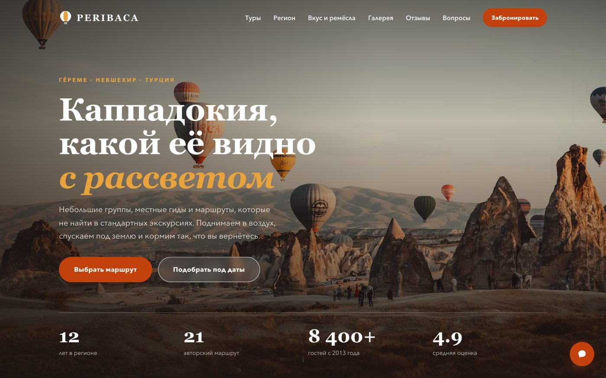
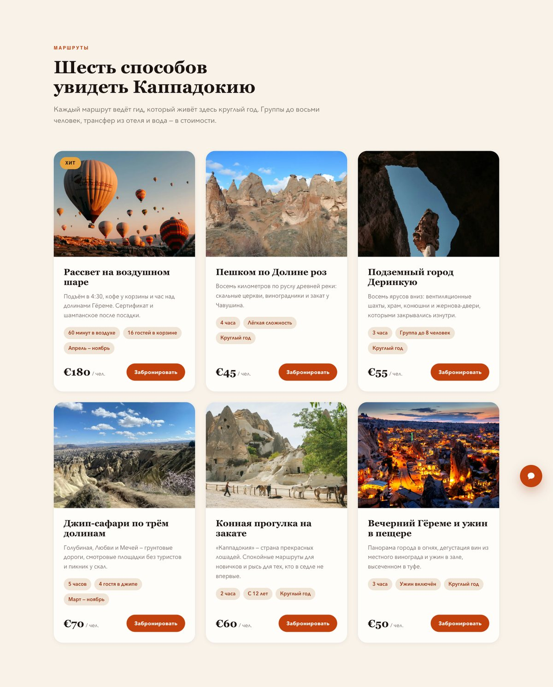
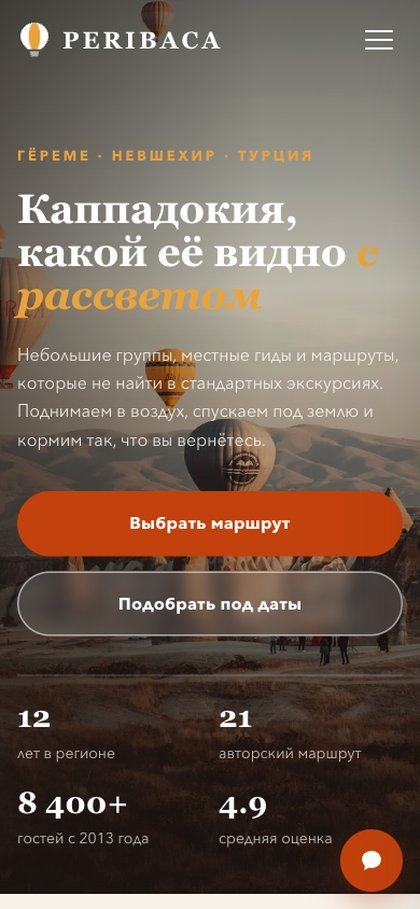

# PERIBACA — лендинг туров по Каппадокии

[](https://peribaca.vercel.app/)

Одностраничный сайт вымышленного туристического агентства: девять экранов, адаптивная вёрстка, ноль зависимостей. Проект вырос из учебного макета 2021 года — от него остались только идея и тема, весь код переписан заново.



## Технологии

- **HTML5 / CSS3** — CSS-переменные, grid, flex, `scroll-snap`, `clamp()`, `aspect-ratio`, `svh`
- **Vanilla JavaScript** — ~500 строк, без jQuery и фреймворков
- **WebP** — все фотографии, у первого экрана отдельные версии для десктопа и мобильных
- **Vercel** — статический хостинг

Из внешних ресурсов остались только Google Fonts. jQuery 3.6 (89 КБ ради одного `toggleClass`) и несжатый JPEG на 1,3 МБ из первой версии удалены.

## Что внутри

| Блок | Реализация |
|------|-----------|
| Первый экран | Фон через `<picture>` с раздельными кадрами под десктоп и мобильные, `preload` + `fetchpriority="high"` |
| Счётчики | Анимация чисел по `IntersectionObserver`, запускается один раз при появлении |
| Туры | Шесть карточек с ценой; выбранный тур подставляется в форму через `data-service` |
| Пакеты | Три тарифа, выделенный сдвигается наверх на мобильных |
| Регион | Коллаж из трёх фото и таймлайн от вулканов до наших дней |
| Кухня и ремёсла | Крупный блок-фича и сетка карточек, шестая — текстовая, для ритма |
| Галерея | Мозаика на CSS Grid без пустот + лайтбокс со стрелками и клавишами `←` `→` `Esc` |
| Отзывы | Карусель на `scroll-snap`: свайп, колесо и клавиши работают нативно, JS — только кнопки |
| Вопросы | Аккордеон на `aria-expanded`, открыт один ответ за раз |
| Заявка | Модальное окно с валидацией, focus-trap и honeypot против ботов |

<p align="center">
  
  
</p>

## Доступность и производительность

- Кольцо фокуса на `:focus-visible`, skip-link, корректные `aria-expanded` / `aria-controls` / `aria-labelledby`
- Закрытое мобильное меню убрано из tab-order, модалка и лайтбокс удерживают фокус внутри и возвращают его при закрытии
- Единый источник блокировки прокрутки: меню, модалка и лайтбокс не перебивают состояние друг друга
- `Esc` закрывает ровно то, что открыто, — по приоритету лайтбокс → модалка → меню → кнопка связи
- Контраст всех текстовых пар проверен и проходит WCAG AA (минимум в палитре — 4,65:1)
- Учитывается `prefers-reduced-motion`, hover-эффекты спрятаны за `(hover: hover)`
- Все `` с явными `width`/`height` и `loading="lazy"` вне первого экрана — верстка не прыгает при загрузке
- Адаптив проверен на 480 / 600 / 768 / 900 / 1024 / 1440 px, горизонтального переполнения нет
- Без JS страница остаётся полностью читаемой: анимации появления включает класс `.js`

## Форма заявки

Работает в демо-режиме: проходит валидацию, показывает подтверждение, но письмо не отправляет. Ключ почтового сервиса в публичном репозитории может использовать кто угодно, поэтому его здесь нет. Флаг `DEMO_MODE` в начале `js/main.js` и закомментированный `fetch` в `sendForm()` возвращают реальную отправку.

## Локальный запуск

Сборка не нужна — достаточно любого статического сервера:

```bash
python3 -m http.server 8000
```

## Заметка

Агентство, цены, отзывы и контакты вымышлены. Сайт закрыт от индексации метатегом `noindex`, чтобы не пересекаться в выдаче с реальными турфирмами. Фотографии — [Unsplash](https://unsplash.com/license), список исходников в [docs/photo-credits.md](docs/photo-credits.md).
